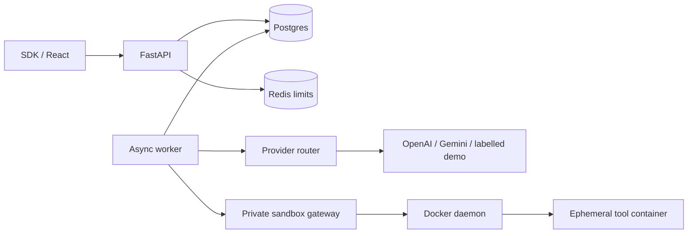
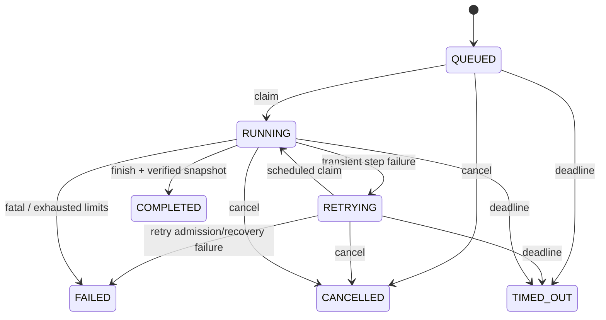

# Architecture and execution semantics

## Product and workflow

AgentForge gives backend/AI developers an API to submit bounded repository-repair jobs that survive worker loss and expose their execution history. Register an immutable agent version; submit a fixture/task with an idempotency key; observe model/tool steps; inspect the saved source and final tests; cancel or retry an unsuccessful run.

Simple agent frameworks do not replace a durable control plane. They can supply planning logic, but persistence, ownership, admission, lease fencing, sandbox policy, and operational recovery still need explicit engineering. This MVP deliberately exposes those concerns in a small runtime.

## Components



API, worker, and gateway share an application image but run separate processes with separate credentials: the API holds the bootstrap operator key and Redis access; the worker holds the provider and gateway keys and is the only service with Internet egress; the gateway holds the Docker socket and is reachable only from the worker. This separation isolates Docker control and model credentials from the public HTTP service. There is no agent framework or message bus. The worker runs one job at a time; scale workers horizontally against PostgreSQL. The gateway bounds concurrent containers to two per process.

## One complete run

1. The API authenticates a high-entropy bearer key, applies Redis rate limiting, validates the body, and locks the owner's API-key row for admission.
2. One database transaction checks the idempotency key and active-run cap, inserts the queued run, immutable initial snapshot, and event. There is no second enqueue write.
3. A worker claims an available run with `SELECT ... FOR UPDATE SKIP LOCKED`, assigns a fresh lease token, and commits. Other workers skip the locked row.
4. The runtime loads the latest checkpoint. If no action is pending, the router selects a provider using explicit preference, conservative cost, remaining budget, and prior failed attempts.
5. Before calling the provider, it persists a STARTED model step and reserves maximum estimated tokens/cost. The adapter returns a validated provider-neutral Action.
6. A transaction guarded by the current unexpired lease commits the successful step, actual usage, next checkpoint, and event. A pending tool action is now durable.
7. The worker persists tool intent and sends a bounded request to the private gateway. The gateway validates it again, creates a disposable non-root container, supplies only the saved files, and runs a fixed operation.
8. Tool stdout/stderr, exit code, duration, and timeout reason return as bounded JSON. A successful write updates the saved source; a test run records its reported outcome. The next snapshot and event commit atomically.
9. The next model action uses the updated context. A finish action is accepted only after a verified test run on the latest source snapshot: exit code 0, no tool limit, and unittest's own summary reporting the fixture's trusted test count followed by `OK`. The terminal state and output commit with an event.

## State machine



Planning and tool execution are typed steps inside RUNNING, not extra run states. RUNNING → RUNNING is a lease recovery, not a state transition; it emits `worker.recovered`. COMPLETED, FAILED, CANCELLED, and TIMED_OUT are immutable terminal states. All unlisted transitions are invalid. Manual retry creates a new linked run instead of rewriting terminal history.

Each logical step has at most three attempts. Failed transient provider/tool transport operations enter RETRYING; `available_at` schedules capped exponential full jitter (up to eight seconds), raised to a provider `Retry-After` delta-seconds hint of up to 30 seconds. Authentication/configuration failures, model refusals, step/token/budget limits, and missing verification terminate.

Planner mistakes are observations, not fatal errors. Nonzero test exit codes, tool deadlines, output limits, and policy rejections (writing a test file, reading a path outside the workspace, or `stats.py` source that imports anything other than `math`, calls `exit`/`eval`/`open`/reflection builtins, or touches dunder attributes) are recorded as the step's result and returned to the planner, which may correct itself within `max_steps`. Three consecutive policy rejections end the run with `RepeatedPolicyViolation`.

## Persisted schema

| Table | Purpose | Important indexes/constraints |
|---|---|---|
| api_keys | Owners (workspaces). Historical name; id was the first operator key's hash and is now just an identifier | Primary id |
| credentials | Hashed bearer keys: owner, label, role, expiry, revocation, creator, last use | Unique key hash; owner index; plaintext never persisted |
| worker_heartbeats | Worker liveness, current run, sandbox readiness, provider catalog | seen_at index; rows older than a day are deleted |
| agents | Immutable versioned JSON execution configuration | Owner index; unique owner/name/version |
| runs | Status, task, fixture, deadline, lease token/expiry, budgets, checkpoint cursor, parent | Unique owner/idempotency; claim index; owner/created index |
| run_steps | Model/tool operation intents, attempts, outcomes, route, usage, duration | Unique run/sequence/attempt; run index |
| checkpoints | Versioned bounded workspace and next action | Unique run/sequence |
| events | Append-only execution observations | run/id cursor index |

`run_steps.kind` distinguishes model_calls and tool_calls. Separate tables would duplicate identifiers, timestamps, status, and retry fields in this MVP. A model step adds provider/model/reason/usage; a tool step adds operation/path/stdout/stderr/exit information. Alembic owns the schema; startup never silently creates production tables.

Persisted run fields include request ID, globally unique UUID run ID, owner ID, agent ID, submission fingerprint, idempotency key, status, timestamps, deadline, retry availability, lease token/expiry, recovery count, cancellation flag, cursor, charged usage, output/error, and optional parent run ID.

## Checkpoint format

```json
{
  "schema_version": 1,
  "sequence": 4,
  "payload": {
    "files": {"stats.py": "...", "test_stats.py": "..."},
    "pending_action": null,
    "last_result": {"stdout":"","stderr":"...","exit_code":1,"duration_ms":73,"timeout_reason":null},
    "tests_passed": false,
    "history": [{"operation":"run_tests","path":"","exit_code":1}]
  }
}
```

The cursor advances only in the transaction that marks a step successful. A worker killed after step four reloads checkpoint four and starts the next logical operation. A worker killed after the provider/tool returned but before commit leaves STARTED intent; recovery marks it UNKNOWN and repeats the uncommitted operation. Unknown model cost/tokens retain the full reservation. Tool execution repeats on a fresh snapshot with no external effects. Successful snapshots are never reconstructed from model text.

Every state-changing worker transaction locks the run and checks status, current lease token, and expiry. The runtime checks/renews the lease every second while waiting for external work. Default lease duration is 30 seconds. Cancellation immediately clears the lease, blocking late commits. It does not promise instantaneous termination of an already executing remote container; its 12-second deadline still bounds work.

Recovery is bounded to three worker-loss recoveries per run. A graceful worker stop (SIGTERM/SIGINT) is not a loss: the worker cancels in-flight work, marks its STARTED step UNKNOWN with `WorkerStopped`, and releases the run to RETRYING for immediate reclaim without consuming a recovery. Each logical step still allows at most three attempts. Queue wait time consumes the absolute run deadline. A worker outage delays timeout materialization until a worker scans the row; the API never promises a separate scheduler daemon.

## Reliability policy

| Failure | Behavior |
|---|---|
| Worker crash | Expired lease is reclaimed; committed steps skipped; unknown intent recorded |
| Duplicate submission/jobs | Owner-scoped idempotency and row locking; one active lease per run |
| Provider outage/rate limit/timeout | Three bounded attempts honouring bounded `Retry-After`; auto policy can choose a configured fallback |
| Graceful worker shutdown | Lease released immediately; run requeued; recovery count unchanged |
| Malformed model response | Validated adapter failure; bounded retry, retained reservation |
| Tool returns nonzero | Recorded observation; planner may repair within step limit |
| Tool/container timeout or output flood | Kill/remove container; limit recorded as an observation for the planner |
| Disallowed tool action or result-faking source | Rejected before execution; recorded as an observation; three in a row fail the run |
| Docker/gateway unavailable | Bounded retry; no execution on API or worker host |
| Redis unavailable | API rate limiting fails closed with 503; workers keep using PostgreSQL |
| Database disconnect | No result commits without DB; worker backs off and later reclaims lease |
| Cancellation | Terminal state and immediate fencing; bounded in-flight cleanup |
| Budget/token exhaustion | Reservation denied before external call; terminal failure |
| Owner daily budget exhausted | `DailyBudgetExhausted` before the external call, across all of the owner's runs created that UTC day |
| Provider exceeds reservation | Actual charge recorded; run fails before any further operation |

At-least-once external execution is explicit. Fencing is an application-level commit guarantee; it cannot recall already sent requests or guarantee exactly-once billing. Provider-side idempotency and reconciliation are future work. Clock synchronization is required across hosts because this baseline uses application wall-clock timestamps. Configure NTP; database-clock leases would be a later improvement.

## Authentication and audit

Each request's bearer key is hashed and looked up in `credentials` (cached per API process for at most five seconds), then checked for revocation, expiry, and role. Role rank is `read` < `submit` < `admin`. Rate limits apply per credential. `run.queued` and `run.cancelled` events record the acting credential id; request logs record method, route template (never raw ids), status, duration, and actor. Key creation and revocation are logged with the creating credential id and stored on the key row.

On startup the API ensures the environment's bootstrap key exists as an admin credential. On a single-owner deployment a new bootstrap key is a rotation: it joins the existing owner and the previous bootstrap key is revoked.

## Workers, health, and retention

Each worker writes a heartbeat every five seconds: current run, gateway readiness, and its provider catalog. `/v1/system` and `/v1/providers` read heartbeats younger than 30 seconds. The worker also touches a tmpfs file after each successful database heartbeat; `python -m agentforge.worker --check` (the Compose healthcheck) fails when that file is older than 30 seconds.

`/metrics` combines per-process HTTP counters with database-derived gauges refreshed at scrape time: runs by status, oldest queued age, RUNNING runs with expired leases, worker heartbeat age, today's estimated spend, and steps by kind/status in the last hour.

`python -m agentforge.admin prune --checkpoint-days N [--run-days M] [--dry-run]` deletes intermediate checkpoints of terminal runs (keeping the final checkpoint the trace shows) and, optionally, whole terminal runs. Queued, running, and retrying runs are never touched.

## Router and provider contract

`LLMProvider.generate(prompt, context) -> Generation(Action, input_tokens, output_tokens)` is the only MVP runtime contract. Adapters validate strict JSON actions and translate usage/errors; vendor response shapes never reach the runtime. Model token streaming, independent health probes, and vendor-native tool-call streaming are intentionally deferred, not empty methods presented as working functionality.

Routing policy: explicit `demo` stays scripted; explicit live provider stays on that provider; `auto` filters live providers by configuration and affordability, then sorts by failure count, conservative request cost, and a deterministic name tie-breaker. Provider/model/reason are recorded before the request. Context length affects reservation cost. No learned task-complexity classifier or model-quality predictor is claimed.

Reservations use UTF-8 prompt/schema bytes plus framing headroom and a 2,048-token output cap. They are conservative estimates, not provider billing enforcement. Configured token rates must be reviewed by the operator. Successful calls reconcile to returned usage; failures retain the reservation. Besides each run's `budget_usd`, `AGENTFORGE_DAILY_BUDGET_USD` (default $2) caps estimated spend across all of an owner's runs created in the current UTC day, checked under the owner's row lock so concurrent workers cannot overshoot it. Spend by a run created before midnight counts toward that earlier day. No circuit breaker is included: bounded attempts and per-owner admission limit the MVP; a shared provider breaker is P2.

## Observability and evaluation

Events and step rows form the durable trace, correlated by run_id and request_id. Production application logs are JSON with allowlisted timestamp, level, service, event, request/run ID, duration, status, and error type. Headers, task bodies, tool output, model responses, and exception messages are not logged. Owner-authenticated trace records intentionally contain bounded source/output for debugging; protect the database accordingly.

Authenticated `/metrics` exposes low-cardinality HTTP counters and latency histograms per API process. Run/model/tool latency, tokens, cost, retries, routes, and errors are available through traces/evaluation. There is no installed OpenTelemetry exporter or distributed trace backend in the MVP. Persisted spans remain inspectable without an external service.

The two-case evaluator compares immutable prompt versions using completion, regression results, tool exit outcomes, retry count, elapsed latency, charged usage, and estimated cost. A failing reproduction test is expected and counts as a nonzero tool exit; tool_success_rate is not task_success_rate. No semantic LLM judge or statistical significance is claimed.

## Scale and deliberate limits

SQLite supports single-worker development and unit tests only. PostgreSQL is required for production/multiple workers and is tested separately for concurrent claims/admission. One owner per deployment, with many role-scoped keys; this is not multi-tenant account management. Owner-scoped queries establish the boundary for later tenants. Files are at most eight Python paths/24KB; only stats.py can be patched. Host paths, Git URLs, package installation, arbitrary commands, and network tools are outside scope.

At larger scale: separate sandbox hosts, enforce per-tenant queues and quotas, add retention/archival, reconciliation, shared circuit breakers, server-side cost contracts, database-clock leases, telemetry exporters, and microVM isolation. Keep those changes driven by measured bottlenecks.
