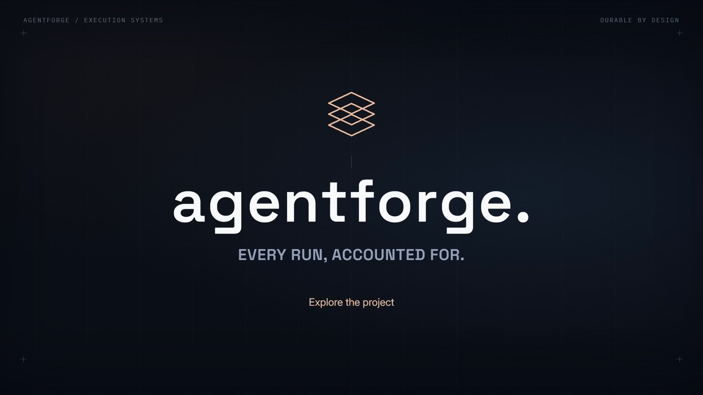
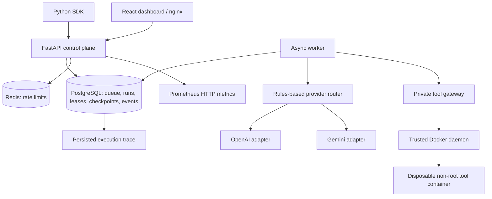

# AgentForge

**A durable execution runtime for repository agents.** Submit a job, inspect every model/tool operation, and resume after a worker crash from the last committed checkpoint.

Agent frameworks make it easy to start a loop. AgentForge focuses on what happens when that loop fails: leases expire, requests are duplicated, providers become unavailable, and tools exceed their limits. The demo agent repairs a bundled Python repository through real disposable Docker containers.

## Launch film

[](assets/media/Project_Launch_Cinematic.mp4)

[Watch or download the 45-second launch film](assets/media/Project_Launch_Cinematic.mp4). Built with Remotion, React, TypeScript, and procedural Three.js geometry at 1920 × 1080 / 30 fps. It follows worker failure, checkpoint recovery, the execution architecture, and an inspectable repair. See the [film source and rendering instructions](video-production/agentforge-launch/README.md).

## Public deployment and live-model evidence

Dashboard: https://agentforge-artignite3.indiasouthcentral.cloudapp.azure.com

The dashboard is publicly reachable; viewing execution data and submitting jobs requires the operator API key. On October 13, 2026, the Azure deployment completed a live Gemini 3.5 Flash-Lite repair (`0e9292f4-6623-4569-8772-68f7bd380c27`). Four model calls and three sandboxed tool calls reproduced failing tests, changed the mean denominator from `len(values) + 1` to `len(values)`, and the unchanged original test file then exited 0. The saved trace reported 8.29 seconds, 2,445 accounted tokens, and $0.005371 estimated accounted cost using configured operator rates, not an invoice. This is one integration result, not a model-quality or performance benchmark.

The model's written explanation incorrectly mentioned Python 2/integer division. Completion verifies the supplied regression tests; explanation accuracy is a separate evaluation criterion, and the dashboard labels the explanation as unverified. That run predates the stricter verification described below (expected test count plus a source policy). Public-host crash recovery/isolation checks and image OS scanning remain additional hardening work. Database backup restoration, encrypted off-host transfer, host updates/reboot, and post-reboot execution were checked by the operator on the Azure host in October 2026; that evidence is kept privately, not in this repository.

## What works

- Authenticated FastAPI control plane and a small Python SDK.
- PostgreSQL job queue with `FOR UPDATE SKIP LOCKED`, expiring leases, fencing tokens, and atomic step/checkpoint/event commits.
- Bounded retries with capped jitter that honours provider `Retry-After` hints (up to 30 s), deadline enforcement, cancellation, idempotent submission, graceful worker shutdown that requeues without consuming a crash recovery, and conservative token/cost admission per run plus a per-owner daily spend cap.
- Planner mistakes (writing a test file, reading a missing path, a tool deadline) come back to the model as observations it can correct, instead of failing the run. A run completes only when unittest reports the fixture's trusted test count and `OK`; `stats.py` source that could fake a pass (`os._exit`, patching `unittest`, reflection) is rejected before execution.
- Provider-neutral adapters: Gemini verified on one live run; the OpenAI Responses adapter is contract-tested against recorded response shapes (including refusals and incomplete responses) but has not been exercised live. Rules-based cost/fallback routing is recorded in traces.
- Tool containers: non-root, no network, no host mounts, read-only root filesystem, CPU/memory/PID/output/time limits. They are started by a private gateway that holds Docker socket access and is therefore a privileged component.
- React/TypeScript dashboard with real runs, timelines, output, agent versions, routing, and checkpoint snapshots.
- 75 automated tests: 70 run anywhere (SQLite, mocked providers); 5 need Docker, PostgreSQL, or the Compose CLI and run in CI. Plus a repeated-trial A/B evaluation script.

`demo` is a **deterministic scripted planner**, clearly labelled throughout the UI. It makes no LLM calls. Its tests still execute in real isolated containers. Use `openai`, `gemini`, or `auto` for live inference; these policies never silently fall back to the demo.

## Architecture



PostgreSQL is both the queue and state store. Submission cannot commit a run while losing a separate enqueue write. Redis outages do not lose jobs; authenticated API requests fail closed while distributed rate limiting is unavailable.

## Quick start

Requirements: Docker with Linux containers, Docker Compose v2, and Python 3.11+ for credential generation. On Linux, set `DOCKER_GID` in `.env` to the group ID from `stat -c '%g' /var/run/docker.sock`.

```sh
python scripts/bootstrap.py
docker compose up --build
```

Open **http://localhost:8080**. Select **Connect workspace** and paste `AGENTFORGE_API_KEY` from the generated, gitignored `.env`. Launch a run using the deterministic demo planner. API docs: **http://localhost:8000/docs** (development only; production serves the OpenAPI schema but not the interactive pages). Only frontend and API ports are bound, both to localhost by default.

The startup sequence builds the tool image, starts PostgreSQL/Redis, applies Alembic migrations, checks sandbox/API readiness, and starts the worker. Subsequent starts need only `docker compose up`.

To use a live model, set `AGENTFORGE_OPENAI_KEY` or `AGENTFORGE_GEMINI_KEY` in `.env`, then recreate API and worker with `docker compose up -d`. Model IDs, conservative micro-USD/token estimates, and `AGENTFORGE_DAILY_BUDGET_USD` (estimated spend across all runs per UTC day, default $2) are configurable. Also set a spending cap in the provider's own console; AgentForge's limits are estimates. The example rates are **operator estimates, not current provider pricing**. Verify availability and pricing for your own account.

Gemini defaults to `gemini-3.8-flash`. The adapter uses its structured JSON response format and low thinking level, excludes thought summaries when parsing actions, and includes thinking tokens in output accounting. Existing Gemini 2.5 configurations retain their older request format, but new accounts may be denied access to those models. For an existing production deployment, update the model and rate fields in `.env.production` explicitly; a source update does not overwrite that private file. Non-rate-limit HTTP failures record only their status code, never upstream error bodies or keys.

The REST response format uses enum names (`APPLICATION_JSON`, `LOW`), rather than SDK-style MIME strings. Provider tests validate these values against a snapshot of Google's discovery schema; the legacy `responseMimeType` field still uses `application/json`.

## API example

```sh
curl http://localhost:8000/v1/agents \
  -H "Authorization: Bearer $AGENTFORGE_API_KEY" \
  -H 'Content-Type: application/json' \
  -d '{"name":"repo-engineer","version":"v1","provider":"demo"}'

curl http://localhost:8000/v1/runs \
  -H "Authorization: Bearer $AGENTFORGE_API_KEY" \
  -H 'Idempotency-Key: repair-001' \
  -H 'Content-Type: application/json' \
  -d '{"agent_id":"<returned-agent-id>","fixture":"mean","task":"Repair stats.py and rerun the original tests."}'
```

Reuse the idempotency key when retrying an ambiguous HTTP submission. The same key and request return the same run; a different body returns 409. `POST /v1/runs/{id}/retry` creates a **new run from the original fixture**, linked to its unsuccessful parent. Automatic worker recovery resumes the existing run from its latest checkpoint.

## Python SDK

```sh
uv sync --extra dev
uv run python scripts/demo.py
```

```python
import os
from agentforge import AgentForge, Agent

with AgentForge(api_key=os.environ["AGENTFORGE_API_KEY"]) as client:
    agent = Agent(name="repo-engineer", provider="demo", timeout=120, budget_usd=0.20)
    run = client.run(agent=agent, task="Repair the failing statistics tests.",
                     idempotency_key="my-repair-001")
    completed = client.wait(run["id"])
    print(completed["status"], completed["output"])
```

The SDK submits immediately; `wait()` is optional and has its own local timeout. A client timeout does not cancel server work. The MVP accepts only bundled fixtures, not remote repository URLs or host paths.

## Dashboard

The dashboard uses live API data and keeps its API key only in memory. It provides Overview, Runs, Run details, Agents, Providers, and System health. Model and tool outputs are rendered as text, never HTML.

## Repository layout

```text
src/agentforge/                  API, runtime, providers, persistence, and SDK
frontend/                       React dashboard and its image build
sandbox/                        Isolated tool runner and its image build
migrations/                     Alembic database migrations
deploy/                         HTTPS edge and production deployment guide
scripts/                        Bootstrap, deployment, backup, and release tools
tests/                          Unit and integration tests
evals/                          Evaluation dataset and runner
assets/media/                   Finished launch film and README poster
video-production/agentforge-launch/
  src/                          Remotion composition and motion components
  creative/                     Approved narration, subtitles, and storyboard
  public/                       Bundled fonts, audio, and dashboard references
  licenses/                     Asset licenses and provenance
  scripts/                      Rendering and asset preparation tools
```

Root configuration defines the Python package, Compose services, migrations, and CI. The dashboard and film have independent npm lockfiles. The film is an optional production package and is excluded from application Docker images.

Credentials, databases, backups, installed dependencies, local reports, and render intermediates are ignored by Git. Put private operational material under `.local/`; film renders and checks write to the ignored `out/`, and audio preparation writes intermediates to the ignored `work/`. Only the curated finished film and poster belong in `assets/media/`. Docker build contexts allow only the inputs needed by each image.

## Verification

```sh
uv sync --frozen --extra dev
uv run ruff check src tests sandbox migrations scripts evals
uv run ruff check video-production/agentforge-launch/scripts
uv run mypy src/agentforge
uv run pytest -q
uv run bandit -r src sandbox -q
uv run pip-audit --local --skip-editable
cd frontend && npm ci && npm run build && npm audit
```

Real isolation tests require the Docker engine and `agentforge-tool:local` image. Set `RUN_DOCKER_TESTS=1` and run pytest. To verify PostgreSQL concurrency, set `POSTGRES_TEST_URL` to a disposable PostgreSQL database and run `pytest -m postgres`; the test creates and removes only its own randomly named schema.

```sh
uv run python evals/compare.py --provider demo --trials 5
```

The evaluator runs each of two immutable prompt versions against each case `--trials` times (default 3). Per run it records verified completion, model and tool call counts, policy rejections, retried attempts, recoveries, tokens, and estimated cost. Latency is split into **queue wait** (submission to first claim) and **execution** (first claim to terminal state), so a busy single-worker queue does not inflate execution numbers. Summaries report the median and nearest-rank p95 execution time and the verified rate. Client-side failures are recorded as errors rather than aborting the report.

Demo versions use the same scripted planner, so identical results are expected. This is an infrastructure check, not evidence of model quality. With two cases and a handful of trials the numbers are descriptive only; model A/B conclusions need live providers, more cases, and enough trials for a significance test.

## Security and reliability

See [SECURITY.md](SECURITY.md) for the threat model, controls, and limitations, and [ARCHITECTURE.md](ARCHITECTURE.md) for state transitions, schema, recovery semantics, and failure policy.

The gateway is a trusted service with Docker control. API, worker, and tool containers do not mount the Docker socket. Tool containers have no secrets, network, or host filesystem mounts. Docker shares a kernel; hostile public multi-tenant execution requires a stronger isolation boundary such as a dedicated sandbox VM or microVM service.

External provider calls can execute more than once across a crash or ambiguous timeout. Fencing protects **database commits**, not provider billing. Unknown calls retain their full reservation. Estimated spend is not an invoice or a provider-enforced account limit. Passing a regression suite is not proof that adversarial code is correct.

## Deployment

Start with the [step-by-step hosting guide](deploy/README.md). The production override adds a non-root Caddy HTTPS edge, removes direct API/frontend host ports, and uses a separately generated `.env.production`. Preflight/release verification and binary-safe backup helpers are included. The guide covers student-credit hosting, DNS, SSH, firewall rules, deployment, verification, restoration, and rollback.

The complete Docker gateway needs a Docker-capable host; ordinary serverless application hosting is insufficient for that component. On a dedicated Linux VM, generate `.env`, set the socket group, configure `AGENTFORGE_ENVIRONMENT=production` and exact HTTPS origins, start Compose, and reverse-proxy localhost:8080 behind TLS. Keep database/Redis/gateway ports private. Back up the PostgreSQL volume with `pg_dump` and test restoration.

CI runs lint, type checking, unit tests, real PostgreSQL/Docker tests, dependency/security checks, migrations, and image builds. Public deployment still requires an operator-owned host/domain and credentials. A local Compose success alone does not establish production readiness.

## Decisions and trade-offs

| Decision | Why | Trade-off |
|---|---|---|
| PostgreSQL queue instead of Celery/Redis queue | Transactional submission, fewer recovery failure modes | Polling and database contention at high scale |
| Small explicit runtime loop | Execution semantics remain inspectable | No general graph/multi-agent DSL |
| Snapshot-based repository tools | Recovery cannot repeat external filesystem effects | Bounded fixtures; no large arbitrary repositories |
| HTTP provider adapters with Pydantic actions | Vendor-neutral runtime and testable parsing | Limited provider feature coverage |
| Rule-based router | Auditable and reproducible | No learned quality prediction |
| Conservative reservation ledger | Ambiguous calls cannot evade admission limits | Spend/token estimates can overcount failures |
| Docker gateway | Practical isolation and resource controls | Gateway/daemon remain a privileged trust boundary |

## Scope and future work

This is a **production-style reference implementation for a single trusted operator**, not enterprise production software. Known gaps found in the November 2026 audit and not yet fixed: a single shared operator key (no per-user identity, scopes, or revocation), one flat Compose network with a password-less Redis, application images pinned by tag rather than digest, no log rotation for application containers, no worker metrics or alerting, and manual-only backups. Other deferred work: general repositories, shell/Python tools, streaming model tokens/SSE, user accounts and RBAC, distributed circuit breakers, tracing exporters, retention enforcement, arbitrary checkpoint replay, gVisor/Firecracker, learned routing, and larger semantic evaluations.
