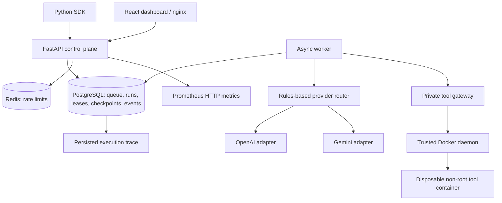

# AgentForge

**A durable execution runtime for repository agents.** Submit a job, inspect every model/tool operation, and resume after a worker crash from the last committed checkpoint.

Agent frameworks make it easy to start a loop. AgentForge focuses on what happens when that loop fails: leases expire, requests are duplicated, providers become unavailable, and tools exceed their limits. The demo agent repairs a bundled Python repository through real disposable Docker containers.

## What works

- Authenticated FastAPI control plane and a small Python SDK.
- PostgreSQL job queue with `FOR UPDATE SKIP LOCKED`, expiring leases, fencing tokens, and atomic step/checkpoint/event commits.
- Bounded retries with jitter, deadline enforcement, cancellation, idempotent submission, and conservative token/cost admission.
- Vendor-neutral OpenAI and Gemini adapters; explicit rules-based cost/fallback routing recorded in traces.
- Private Docker tool gateway: non-root, no network, no host mounts, read-only root filesystem, CPU/memory/PID/output/time limits.
- React/TypeScript dashboard with real runs, timelines, output, agent versions, routing, and checkpoint snapshots.
- Regression fixtures, crash-recovery tests, real Docker/PostgreSQL integration tests, A/B evaluation script, and CI.

`demo` is a **deterministic scripted planner**, clearly labelled throughout the UI. It makes no LLM calls. Its tests still execute in real isolated containers. Use `openai`, `gemini`, or `auto` for live inference; these policies never silently fall back to the demo.

## Architecture



PostgreSQL is both the queue and state store. Submission cannot commit a run while losing a separate enqueue write. Redis outages do not lose jobs; authenticated API requests fail closed while distributed rate limiting is unavailable.

## Quick start

Requirements: Docker with Linux containers, Docker Compose v2, and Python 3.11+ for credential generation. On Linux, set `DOCKER_GID` in `.env` to the group ID from `stat -c '%g' /var/run/docker.sock`.

```sh
python scripts/bootstrap.py
docker compose up --build
```

Open **http://localhost:8080**. Select **Connect workspace** and paste `AGENTFORGE_API_KEY` from the generated, gitignored `.env`. Launch a run using the deterministic demo planner. API docs: **http://localhost:8000/docs**. Only frontend and API ports are bound, both to localhost by default.

The startup sequence builds the tool image, starts PostgreSQL/Redis, applies Alembic migrations, checks sandbox/API readiness, and starts the worker. Subsequent starts need only `docker compose up`.

To use a live model, set `AGENTFORGE_OPENAI_KEY` or `AGENTFORGE_GEMINI_KEY` in `.env`, then recreate API and worker with `docker compose up -d`. Model IDs and conservative micro-USD/token estimates are configurable. The example rates are **operator estimates, not current provider pricing**. Verify availability and pricing for your own account.

## API example

```sh
curl http://localhost:8000/v1/agents \
  -H "Authorization: Bearer $AGENTFORGE_API_KEY" \
  -H 'Content-Type: application/json' \
  -d '{"name":"repo-engineer","version":"v1","provider":"demo"}'

curl http://localhost:8000/v1/runs \
  -H "Authorization: Bearer $AGENTFORGE_API_KEY" \
  -H 'Idempotency-Key: repair-001' \
  -H 'Content-Type: application/json' \
  -d '{"agent_id":"<returned-agent-id>","fixture":"mean","task":"Repair stats.py and rerun the original tests."}'
```

Reuse the idempotency key when retrying an ambiguous HTTP submission. The same key and request return the same run; a different body returns 409. `POST /v1/runs/{id}/retry` creates a **new run from the original fixture**, linked to its unsuccessful parent. Automatic worker recovery resumes the existing run from its latest checkpoint.

## Python SDK

```sh
uv sync --extra dev
uv run python scripts/demo.py
```

```python
import os
from agentforge import AgentForge, Agent

with AgentForge(api_key=os.environ["AGENTFORGE_API_KEY"]) as client:
    agent = Agent(name="repo-engineer", provider="demo", timeout=120, budget_usd=0.20)
    run = client.run(agent=agent, task="Repair the failing statistics tests.",
                     idempotency_key="my-repair-001")
    completed = client.wait(run["id"])
    print(completed["status"], completed["output"])
```

The SDK submits immediately; `wait()` is optional and has its own local timeout. A client timeout does not cancel server work. The MVP accepts only bundled fixtures, not remote repository URLs or host paths.

## Dashboard

The dashboard uses live API data and keeps its API key only in memory. It provides Overview, Runs, Run details, Agents, Providers, and System health. Model and tool outputs are rendered as text, never HTML. Local visual captures are saved under `docs/screenshots/`, currently excluded by this checkout's Git rules.

## Verification

```sh
uv sync --frozen --extra dev
uv run ruff check src tests sandbox migrations scripts evals
uv run mypy src/agentforge
uv run pytest -q
uv run bandit -r src sandbox -q
uv run pip-audit --local --skip-editable
cd frontend && npm ci && npm run build && npm audit
```

Real isolation tests require the Docker engine and `agentforge-tool:local` image. Set `RUN_DOCKER_TESTS=1` and run pytest. To verify PostgreSQL concurrency, set `POSTGRES_TEST_URL` to a disposable PostgreSQL database and run `pytest -m postgres`; the test creates and removes only its own randomly named schema.

```sh
uv run python evals/compare.py --provider demo
```

The evaluator reports task completion, supplied-regression pass rate, tool exit success, retries, latency, tokens, and estimated cost for two immutable agent prompt versions. Demo versions use the same scripted planner; identical success is expected. This is an infrastructure check, not evidence of model quality. A/B model conclusions require live providers, more cases, and repeated trials.

## Security and reliability

See [SECURITY.md](SECURITY.md) for the threat model, controls, and limitations, and [ARCHITECTURE.md](ARCHITECTURE.md) for state transitions, schema, recovery semantics, and failure policy.

The gateway is a trusted service with Docker control. API, worker, and tool containers do not mount the Docker socket. Tool containers have no secrets, network, or host filesystem mounts. Docker shares a kernel; hostile public multi-tenant execution requires a stronger isolation boundary such as a dedicated sandbox VM or microVM service.

External provider calls can execute more than once across a crash or ambiguous timeout. Fencing protects **database commits**, not provider billing. Unknown calls retain their full reservation. Estimated spend is not an invoice or a provider-enforced account limit. Passing a regression suite is not proof that adversarial code is correct.

## Deployment

Start with the [step-by-step hosting guide](deploy/README.md). The production override adds a non-root Caddy HTTPS edge, removes direct API/frontend host ports, and uses a separately generated `.env.production`. Preflight/release verification and binary-safe backup helpers are included. The guide covers student-credit hosting, DNS, SSH, firewall rules, deployment, verification, restoration, and rollback.

The complete Docker gateway needs a Docker-capable host; ordinary serverless application hosting is insufficient for that component. On a dedicated Linux VM, generate `.env`, set the socket group, configure `AGENTFORGE_ENVIRONMENT=production` and exact HTTPS origins, start Compose, and reverse-proxy localhost:8080 behind TLS. Keep database/Redis/gateway ports private. Back up the PostgreSQL volume with `pg_dump` and test restoration. Detailed deployment notes are in the local `DEPLOYMENT.md`, currently excluded by this checkout's Git rules.

CI runs lint, type checking, unit tests, real PostgreSQL/Docker tests, dependency/security checks, migrations, and image builds. Public deployment still requires an operator-owned host/domain and credentials. A local Compose success alone does not establish production readiness.

## Decisions and trade-offs

| Decision | Why | Trade-off |
|---|---|---|
| PostgreSQL queue instead of Celery/Redis queue | Transactional submission, fewer recovery failure modes | Polling and database contention at high scale |
| Small explicit runtime loop | Execution semantics remain inspectable | No general graph/multi-agent DSL |
| Snapshot-based repository tools | Recovery cannot repeat external filesystem effects | Bounded fixtures; no large arbitrary repositories |
| HTTP provider adapters with Pydantic actions | Vendor-neutral runtime and testable parsing | Limited provider feature coverage |
| Rule-based router | Auditable and reproducible | No learned quality prediction |
| Conservative reservation ledger | Ambiguous calls cannot evade admission limits | Spend/token estimates can overcount failures |
| Docker gateway | Practical isolation and resource controls | Gateway/daemon remain a privileged trust boundary |

## Scope and future work

This is a **portfolio-oriented production baseline**, not enterprise production software. Deferred work: general repositories, shell/Python tools, streaming model tokens/SSE, user accounts and RBAC, distributed circuit breakers, tracing exporters, retention enforcement, arbitrary checkpoint replay, gVisor/Firecracker, learned routing, and larger semantic evaluations.

The practical build plan, original idea comparison, release checklist, validation record, and screenshots are retained locally under `docs/`. This checkout currently ignores that directory in Git.
